# How `harness_mvp` works: execution flow from command line to report

This document traces what actually happens when you run the harness, from the entry point to the
files it writes. It covers the application package `harness_mvp/`. The `codemap/` package
(an interactive code map) and `tests/` are separate and are mentioned only where they matter.

Every node cites `file:line` from the source as of 2026-10-22. Line numbers drift as the code
changes, so if one looks off, search for the function name.

## How to read this document

| Label | Meaning |
|---|---|
| **Verified** | Read directly in the source: the call is written literally at that line. |
| **Dynamic** | The target is chosen at runtime (e.g. which model or runner object is passed in). The possible targets are listed, and the line that makes the choice is cited. |
| **Observed** | Seen when running `python -m harness_mvp run --mock` on 2026-10-22 (offline, scripted model, Docker runner). |

Diagrams use solid arrows for verified calls and dotted arrows (`-.->`) for dynamic dispatch.
Nothing here is asynchronous: the code has no `async`, threads or event loops, and every model
request and test run blocks until it finishes. There is no database. All state is kept in memory
and written to JSON/JSONL files in the run directory.

**External systems the code talks to** (verified by searching for `urlopen` and `subprocess.run`):

| System | Where | Purpose |
|---|---|---|
| HTTP `POST {HARNESS_BASE_URL}/chat/completions` | `harness_mvp/model.py:175` | the only network call; live mode only |
| `docker` CLI | `harness_mvp/runner.py:112, 122, 128, 184, 187` | check daemon, check/build image, run tests, remove a stuck container |
| `git` CLI | `harness_mvp/main.py:31, 34` | record the code version in the manifest |
| host `python -m unittest` | `harness_mvp/runner.py:234` | mock mode without Docker only, allowlisted code only |
| `.env` file / environment variables | `harness_mvp/model.py:93-104, 126-137` | model settings and API key |

---

## 1. Entry points

All four CLI commands share one entry point.

| Entry point | File:line | What it does |
|---|---|---|
| `python -m harness_mvp <command>` | `harness_mvp/__main__.py:5` | `sys.exit(main())` |
| `main(argv)` | `harness_mvp/main.py:319` | parses arguments, then calls `args.func(args)` (line 321) |
| `run` → `cmd_run` | `harness_mvp/main.py:70` | **the main workflow**: optimize, select, evaluate held-out, report |
| `smoke` → `cmd_smoke` | `harness_mvp/main.py:209` | checks the task suite and the runner (+ one synthetic episode with `--mock`); never calls the API |
| `report` → `cmd_report` | `harness_mvp/main.py:261` | regenerates `report.md` from an existing run directory |
| `build-image` → `cmd_build_image` | `harness_mvp/main.py:268` | builds the Docker runner image |
| unit tests | `tests/test_*.py` | `python -m unittest discover -s tests -t .`; they call library functions directly with fake models and runners |

**Dynamic dispatch at the top.** `main` does not name the command function. `build_parser`
(`main.py:276`) registers one handler per sub-command with `set_defaults(func=...)` (lines 286,
307, 311, 315), and `main.py:321` calls whichever one argparse stored. The mapping is fixed in
code, so it is fully determined by the sub-command you type.

---

## 2. High-level workflow (`python -m harness_mvp run`)

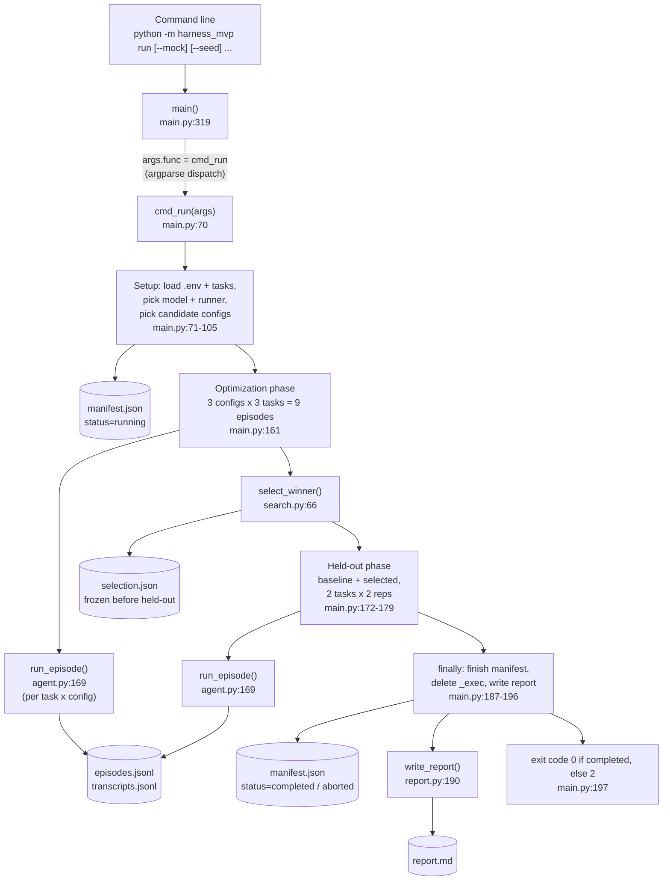

**Step by step**

1. `__main__.py:5` calls `main()`. `main` builds the parser and argparse dispatches to `cmd_run`
   (**dynamic**, but determined by the `run` sub-command).
2. `cmd_run` prepares everything: environment, tasks, output folder, model backend, test runner,
   the list of candidate harness configurations and a global call budget. It writes
   `manifest.json` with `status: running` (`main.py:135`).
3. **Optimization phase.** Each candidate configuration runs once on each of the three
   optimization tasks (`main.py:161`). Every episode is appended to `episodes.jsonl` as it finishes.
4. **Selection.** `select_winner` ranks the candidates using optimization episodes only. The result
   is written to `selection.json` *before* any held-out episode runs (`main.py:164`), so the held-out
   results cannot influence the choice.
5. **Held-out phase.** The baseline and the selected configuration each run on the two test tasks,
   twice (`main.py:175-179`).
6. A `finally` block always runs. It closes the files, stamps `finished_at` and the number of calls
   used, deletes the scratch `_exec` folder, and writes `report.md` (`main.py:187-196`).
7. The process exits with code 0 if the run completed, otherwise 2.

**Observed (mock run):** the candidates were `direct+full, structured+full, direct+compact`. There
were 9 optimization episodes and 8 held-out episodes; `structured+full` was selected (3/3 solved);
27 of the 34 allowed model calls were used.

| Node | File:line | Responsibility | Input → Output |
|---|---|---|---|
| `main` | `main.py:319` | parse CLI, dispatch | `argv` → exit code from the handler |
| `cmd_run` | `main.py:70` | orchestrate the whole experiment | parsed `args` → `0`/`2`, files in the run dir |
| `run_episode` | `agent.py:169` | one repair attempt sequence for one task + config | task, config, model, runner, budget → (episode record, transcript entries) |
| `select_winner` | `search.py:66` | rank configs on optimization results | candidates + optimization episodes → selection dict |
| `write_report` | `report.py:190` | render the Markdown report | run dir → path of `report.md` |

---

## 3. `cmd_run` in detail

### 3a. Setup and decision points

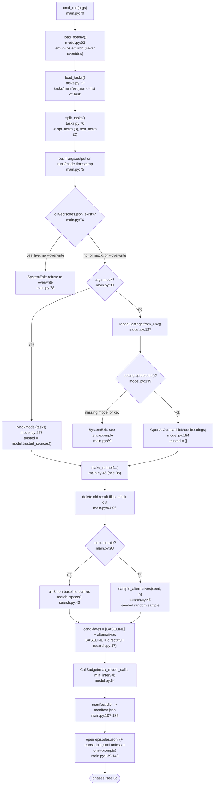

**Step by step**

1. **Environment.** `load_dotenv` copies `KEY=VALUE` lines from `.env` into the environment and
   never overwrites variables already set in the shell.
2. **Tasks.** `load_tasks` reads `tasks/manifest.json`. For each entry it builds a frozen `Task`
   (id, split, signature, statement, folder path). It raises if a split is invalid, a task file
   is missing or an id is duplicated. `split_tasks` separates `optimization`
   (`merge_intervals`, `stable_dedupe`, `top_k_words`) from `test` (`saturating_add`,
   `chunk_string`).
3. **Overwrite guard.** A live run refuses to reuse a directory that already has `episodes.jsonl`
   unless you pass `--overwrite`. Mock runs always overwrite.
4. **Model choice.** This is the dispatch point for every later `model.complete(...)` call.
   - **Mock:** `MockModel` returns scripted replies, and `trusted_sources()` lists every source
     the mock can emit, which feeds the local runner's allowlist.
   - **Live:** `ModelSettings.from_env` reads the `HARNESS_*` variables. Missing model or key
     stops the run before any request.
5. **Runner choice.** `make_runner` (next diagram) picks Docker or the trusted local runner. This
   is the dispatch point for every later `runner.run(...)` call.
6. **Candidates.** The candidates are the baseline `direct+full` plus either all three other
   configurations (`--enumerate`) or `n` of them sampled with `random.Random(seed)`. The same seed
   always gives the same sample.
7. **Budget.** A single `CallBudget` object is shared by every episode. It enforces the global cap
   on model requests.
8. The manifest records the settings, task file hashes, runner description, code version (from
   `git` or a hash of the sources) and the command line.

| Node | File:line | Responsibility | Input → Output |
|---|---|---|---|
| `load_dotenv` | `model.py:93` | load `.env` | path → mutates `os.environ` |
| `load_tasks` | `tasks.py:52` | read and validate the task suite | `tasks/` dir → `list[Task]` |
| `split_tasks` | `tasks.py:70` | separate by split | tasks → (optimization, test) |
| `ModelSettings.from_env` | `model.py:127` | read the model configuration | env vars → `ModelSettings` |
| `ModelSettings.problems` | `model.py:139` | validate credentials | settings → list of problems |
| `sample_alternatives` | `search.py:45` | seeded random search | seed, n → `list[HarnessConfig]` |
| `CallBudget` | `model.py:54` | global request cap + pacing | max calls, min interval → gate object |
| `code_version` | `main.py:29` | identify the code | repo → `git:<rev>[-dirty]` or `sources-sha256:<hash>` |

### 3b. Choosing the test runner (`make_runner`, `main.py:45`)

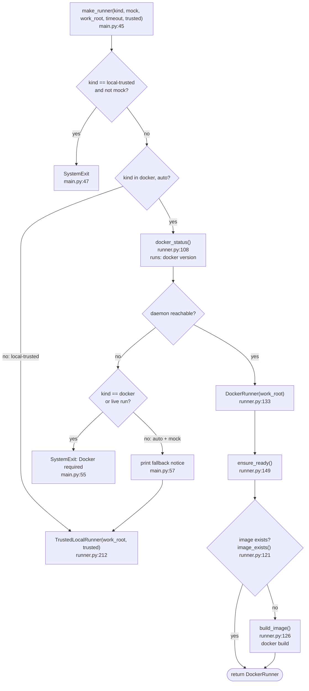

The rule: **model-generated code only ever runs in Docker.** Without Docker, a live run stops.
A mock run falls back to `TrustedLocalRunner`, which refuses any source whose SHA-256 is not on
the allowlist built from repository files (`runner.py:227-228`).

**Observed:** in the mock run Docker was available, so a `DockerRunner` was used, and
`ensure_ready` built the missing image `harness-mvp-runner:py311`.

### 3c. Phases, ordering and error handling

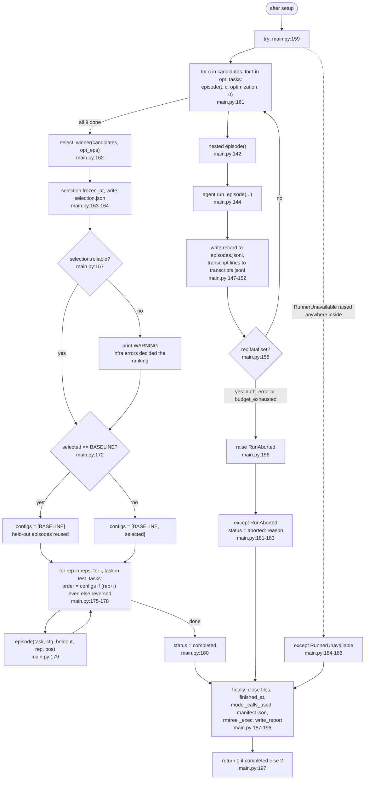

**Step by step**

1. **Optimization.** The list comprehension at `main.py:161` loops over configurations (outer) and
   tasks (inner). Each iteration calls the nested `episode` helper. The helper builds an id like
   `optimization-direct+full-merge_intervals-r0`, calls `agent.run_episode` and immediately appends
   the record to `episodes.jsonl` (flushed, so a crash keeps the finished episodes). It also prints
   one status line.
2. **Fatal outcomes stop the run.** If an episode returns `fatal` (`auth_error` or
   `budget_exhausted`), `episode` raises `RunAborted`. Other failures (bad code, failed tests, API
   errors, timeouts) are recorded and the run continues.
3. **Selection** runs only on the optimization records. A `reliable: false` flag is printed as a
   warning when an API or runner error ended an optimization episode, because such episodes count
   as unsolved and may have decided the ranking.
4. **Held-out.** For each repetition and each test task, both configurations run. The order flips
   whenever `rep + i` is odd, to reduce ordering effects. If the baseline won, only the baseline
   runs, and the report reuses its results for the "selected" column.
5. **Error paths.**
   - `RunAborted` and `RunnerUnavailable` are caught; the status becomes `aborted: ...`.
   - Other exceptions are **not** caught. One example is `PermissionError` from the trusted runner
     (`runner.py:228`). The `finally` block still runs and writes the manifest and the report, and
     then the exception propagates (**verified** from the `try/finally` structure; not observed).

**Observed held-out order (mock run):**
`saturating_add`: baseline, selected → `chunk_string`: selected, baseline → (rep 1)
`saturating_add`: selected, baseline → `chunk_string`: baseline, selected.

---

## 4. One episode: `run_episode` (`agent.py:169`)

This is the core of the program: one task, one configuration, at most `MAX_ATTEMPTS = 2` model
answers (`agent.py:14`).

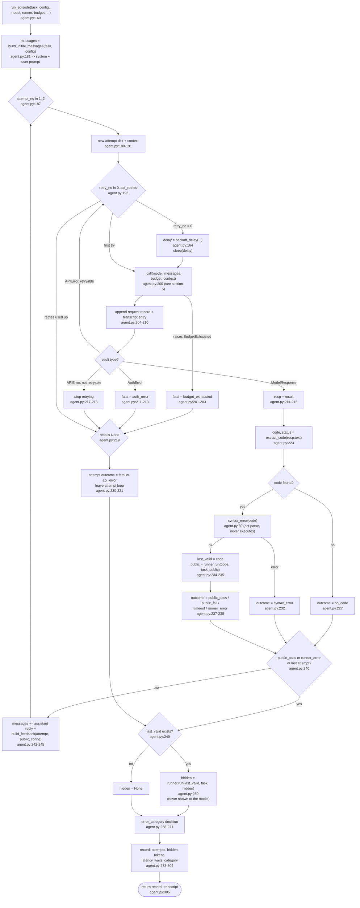

**Step by step**

1. **Prompt.** `build_initial_messages` (`agent.py:43`) creates two chat messages.
   - The **system** message is chosen by `config.instruction_style`: `direct` or `structured`
     (`agent.py:21-33`).
   - The **user** message contains the task contract (signature + statement), the buggy module,
     the public tests and the instruction to return the full module in one code block.
   - The hidden tests and `bug_note` are never included.
2. **Request with optional retries.** Each attempt sends the current conversation through `_call`
   (section 5). The inner retry loop only repeats after a *transient* API error (HTTP 429/5xx or a
   network error), waiting `backoff_delay` seconds. That wait is `base × 2^(n-1)`, at least the
   server's hint, at most 120 s (`agent.py:164-166`). Every re-send passes through the global
   budget again.
3. **Stop conditions inside the request loop.**
   - An `AuthError` or `BudgetExhausted` sets `fatal` and ends the episode, and `cmd_run` then
     aborts the run.
   - A non-retryable error (e.g. HTTP 400) ends the attempt with `api_error`.
4. **Extract code.** `extract_code` (`agent.py:60`) turns the reply text into
   `(code or None, status)`. It tries, in order:
   1. one fenced block → `fenced`
   2. several blocks → the longest Python one (`multiple_fences_longest`)
   3. an opening fence without a closing one → `unterminated_fence`
   4. an unfenced reply that parses as a module → `raw`
   5. otherwise `no_code`
5. **Syntax check.** `syntax_error` only calls `ast.parse`; the candidate is not executed on the
   host.
6. **Public tests.** A syntactically valid candidate becomes `last_valid`. It runs against the
   public tests through `runner.run(code, task, "public")` (**dynamic**: `DockerRunner.run` or
   `TrustedLocalRunner.run`, chosen in `make_runner`). The runner outcome maps to `public_pass`,
   `public_fail`, `timeout` or `runner_error`.
7. **Retry with feedback.** If the attempt did not pass and attempts remain, the model's reply and
   a feedback message are appended to the conversation (`build_feedback`, `agent.py:124`).
   - Feedback for `no_code`, `syntax_error` and `timeout` is a fixed sentence.
   - For failed tests it depends on `config.retry_feedback`:
     - `full`: public stdout+stderr, capped at 4,000 characters by cutting out the middle
       (`_cap_middle`, `agent.py:98`; keeps the first quarter and the last three quarters).
     - `compact`: failed test ids plus up to 5 error lines (`compact_summary`, `agent.py:106`).
   - Only public-test information is used, by construction.
8. **Hidden scoring.** The last valid candidate is run once against the hidden tests in a separate
   execution (`agent.py:250`). The result decides `hidden_success` and is never fed back.
9. **Error category** (first match wins, `agent.py:258-271`):
   1. `fatal`
   2. `none` (hidden tests passed)
   3. `api_error` (an attempt got no response)
   4. the last attempt's `no_code` / `syntax_error` / `timeout` / `runner_error`
   5. `public_test_failure`
   6. the hidden run's `timeout` / `runner_error`
   7. otherwise `hidden_test_failure`
10. **Record.** The episode dict includes per-attempt details, token sums (`None` if any request
    lacks usage; never treated as zero, `agent.py:160`), model latency, deliberate waiting
    (pacing + backoff, excluded from episode latency) and the category.

**Observed paths (mock run):**

| Episode | Attempts | Result |
|---|---|---|
| `merge_intervals` | `public_fail` → `public_pass` | solved on retry |
| `stable_dedupe` | `public_pass` | solved first time |
| `top_k_words` (direct) | `no_code` → `public_fail` | `public_test_failure` |
| `saturating_add` (direct) | `public_pass` | `hidden_test_failure` (passed public, failed hidden) |
| `chunk_string` | `syntax_error` → `public_pass` (parse status `raw`) | solved via the unfenced fallback |

| Node | File:line | Responsibility | Input → Output |
|---|---|---|---|
| `build_initial_messages` | `agent.py:43` | first prompt | `Task`, `HarnessConfig` → `[system, user]` messages |
| `_call` | `agent.py:141` | one gated model request | model, messages, budget, context → (response or `ModelError`, request record) |
| `backoff_delay` | `agent.py:164` | wait before a re-send | retry number, base, server hint → seconds |
| `extract_code` | `agent.py:60` | find the module in the reply | reply text → (code or `None`, parse status) |
| `syntax_error` | `agent.py:89` | parse-only check | code → error message or `None` |
| `runner.run` | `runner.py:177` / `runner.py:226` | execute tests (**dynamic**) | source, task, `public`/`hidden` → `ExecResult` |
| `build_feedback` | `agent.py:124` | retry message | attempt, public `ExecResult`, config → text |
| `ExecResult.to_record` | `runner.py:46` | JSON-safe test result (last 4,000 chars of output) | `ExecResult` → dict |

---

## 5. Sequence: one episode across components (live mode)

This shows the component interactions and the data passed between them. Participant names are the
concrete classes used in a live run; in mock mode, `MockModel` replaces the model and the HTTP
endpoint disappears.

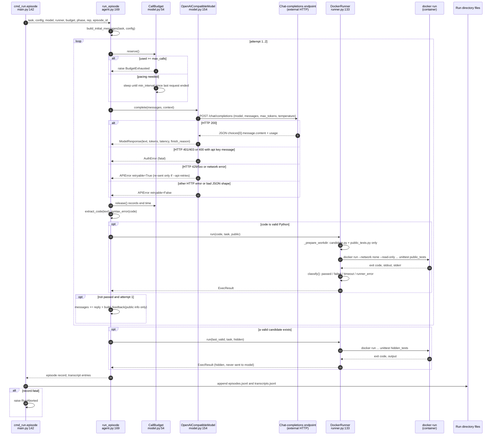

**Step by step**

1. `cmd_run`'s nested `episode` passes all collaborators in; `run_episode` owns no global state
   apart from the shared `CallBudget`.
2. Before each request, `CallBudget.reserve` (`model.py:73`) either raises `BudgetExhausted` (cap
   reached) or optionally sleeps so the next request starts at least `--min-interval` seconds after
   the previous one *finished*. It then counts the request. `_call` always calls `release()` in a
   `finally` (`agent.py:152-153`), even when the request failed.
3. `OpenAICompatibleModel.complete` (`model.py:162`) builds the JSON payload and POSTs it with
   `urllib`.
   - `temperature` is left out when it is set to `none`.
   - The token-limit field name is configurable via `HARNESS_MAX_TOKENS_PARAM`.
   - HTTP errors are classified by `_error_info` (`model.py:204`), which extracts the message and
     a retry hint from the `Retry-After` header or the body.
   - Token usage comes from `usage`; missing values stay `None`.
4. The runner writes a temporary folder with only `candidate.py` and one test file
   (`runner.py:86-95`). It runs one locked-down container (`runner.py:159-175`) and deletes the
   folder in a `finally`.
   - `classify` (`runner.py:71`) reports `passed` only when the exit code is 0, unittest printed
     `OK`, and the number of tests run equals the number of `test_` methods in the file.
   - Exit code 124 means the in-container `timeout` fired.
   - Codes 125-127 without test output mean Docker itself failed (`runner_error`).
   - If the host-side guard expires, the container is force-removed (`runner.py:186-189`).
5. The hidden-test run uses a separate container in which the public test file is absent, and
   vice versa.
6. Back in `cmd_run`, the record is persisted immediately; a fatal record aborts the run.

---

## 6. Selection and report

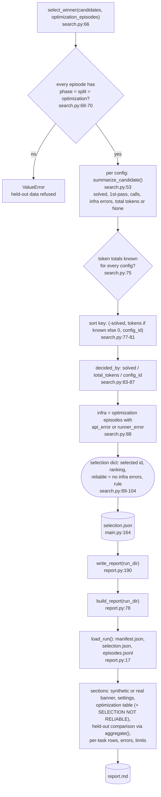

**Step by step**

1. `select_winner` refuses any non-optimization episode, so held-out data cannot leak into the
   choice.
2. For each configuration it counts hidden-test successes and sums tokens. If any episode lacks
   token usage, the total is `None`, and then the token tie-breaker is disabled for *all*
   candidates (`search.py:75`).
3. The ranking is: most tasks solved, then fewest total tokens (only if known for everyone), then
   config id alphabetically. `decided_by` records which rule separated first from second.
4. `reliable` is false if any optimization episode ended in `api_error` or `runner_error`.
5. `build_report` reads only the files on disk (`load_run`), so `report` can be re-run later for
   any run directory.
   - It labels mock results **SYNTHETIC**.
   - It shows the selection table and repeats the reliability warning.
   - It compares baseline and selected configurations on held-out episodes, using `aggregate`
     (`report.py:43`) for success rates, tokens, latency, waits and error categories.
   - It lists every episode and the errors.

**Observed:** the ranking was `structured+full` (3 solved, 3,492 tokens), then `direct+compact`
(2 solved, 2,639), then `direct+full` (2 solved, 2,855). `decided_by` was `solved`. Second and
third place were separated by tokens.

---

## 7. Call graphs

Two focused graphs instead of one large one. Solid arrows are verified calls. Dotted arrows are
**dynamic**: the target depends on an object created earlier, and the label says where the choice
is made. Numbers are line numbers in the file named in the box.

### 7a. Orchestration: commands to modules

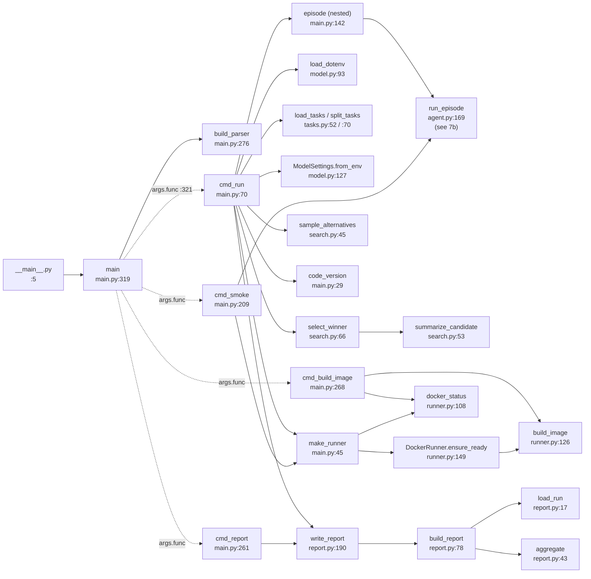

`cmd_run` is the hub: it calls into every module directly and reaches the agent only through the
nested `episode` helper. `cmd_smoke` reuses `make_runner` and `run_episode` but makes no API call.
In live preflight it only checks credentials and Docker; with `--mock` it runs one synthetic
episode (`main.py:248-254`). `search.py`, `tasks.py` and `report.py` never call back into
`main.py` or `agent.py`.

### 7b. Inside an episode: agent, model, runner

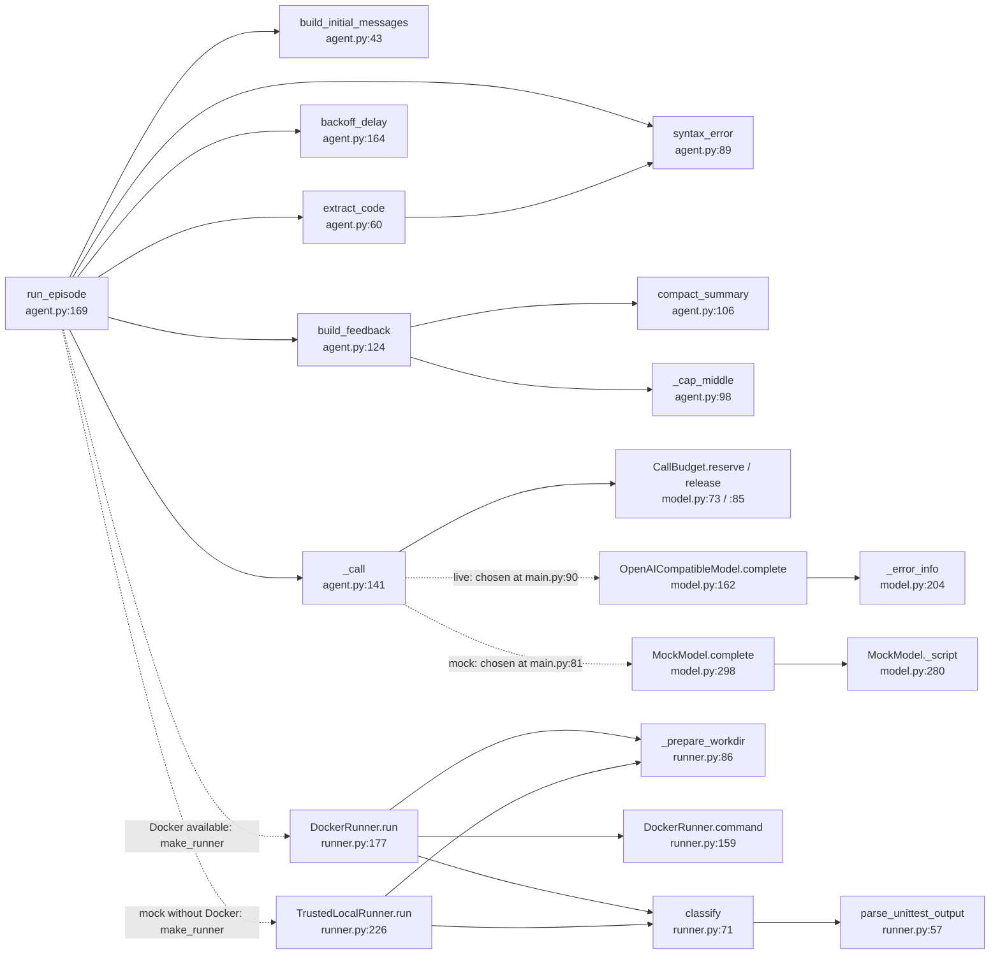

`run_episode` is the only function that talks to both a model and a runner, and it does so through
objects it receives as arguments. The source at `agent.py:146` says `model.complete(...)`, and
`agent.py:235` and `:250` say `runner.run(...)`; which class answers is decided in `cmd_run`. That
is why those edges are dotted. The unit tests pass their own fakes here (`tests/test_agent.py`).

---

## 8. Data lineage: what each stage turns into what

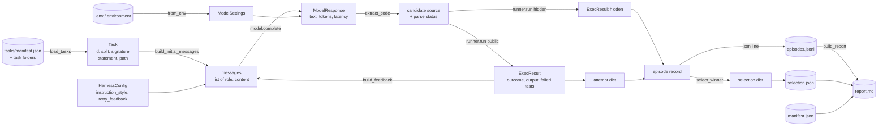

| Stage | Produced by | Shape |
|---|---|---|
| `Task` | `tasks.py:58` | frozen dataclass; sources are read lazily from disk via properties (`tasks.py:31-41`) |
| `messages` | `agent.py:52`, extended at `agent.py:242` | list of `{"role", "content"}` |
| `ModelResponse` | `model.py:198` / `model.py:304` | text, input/output/total tokens (or `None`), latency, finish reason |
| request record | `agent.py:148-157` | ok flag, error category/message, HTTP status, retry hint, tokens, latency |
| `ExecResult` | `runner.py:199` / `runner.py:244` | outcome, return code, capped stdout/stderr, tests run vs expected, failed test ids |
| attempt dict | `agent.py:188` | requests, outcome, parse status, candidate hash, syntax error, public result |
| episode record | `agent.py:273-304` | one JSON line per episode, see `README.md` → Outputs |
| selection | `search.py:89-104` | selected id, ranking with stats, rule, reliability |

---

## 9. Other commands

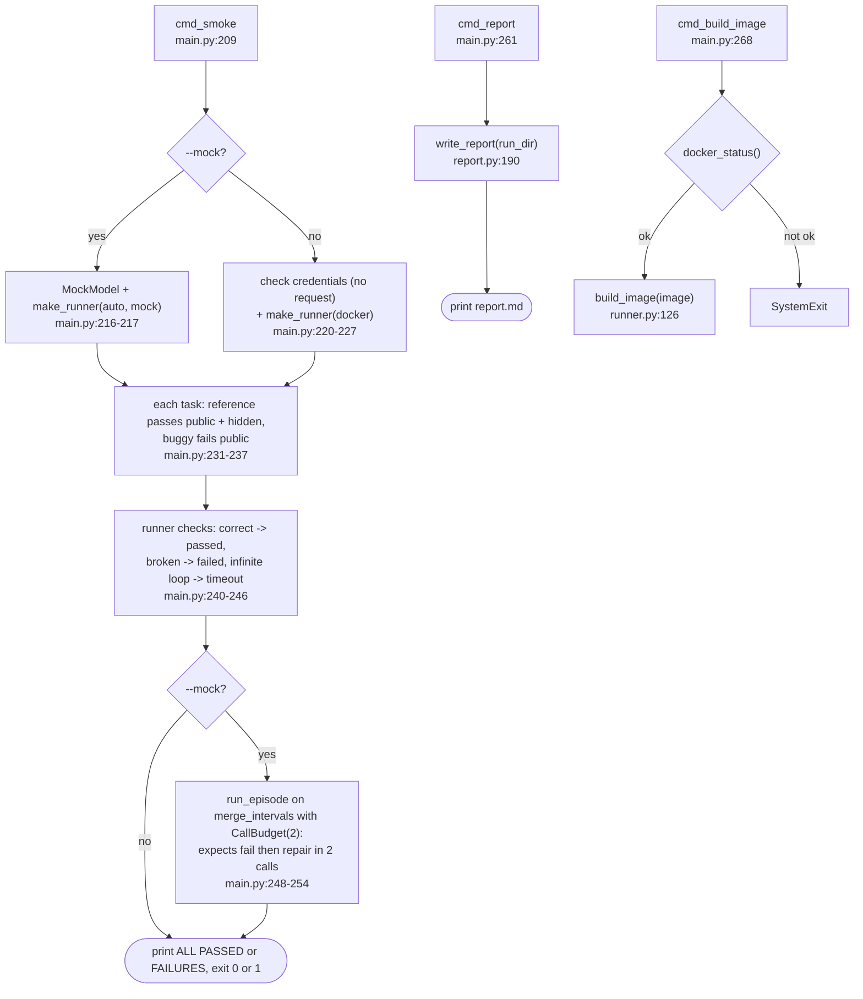

`smoke` never sends a model request. In live mode it only checks that credentials are present
and that Docker works. This lets you validate a setup for free before `run`.

---

## 10. Verified, dynamic and assumed

**Verified in the source**

- The call order and branches in sections 3-6, including the stop conditions and error categories.
- Held-out data cannot reach selection (`search.py:68-70`) or the model (`agent.py:247-251`; the
  hidden result is only stored in the record).
- Model-generated code runs only in Docker. The local runner checks a hash allowlist
  (`runner.py:227`), and live mode exits if Docker is missing (`main.py:54-56`).
- The budget is checked before every request, including retries (`agent.py:143`, `model.py:74-75`).
- No async code, threads or database exist in `harness_mvp/`.

**Dynamic (decided at runtime)**

| Call site | Possible targets | Decided at |
|---|---|---|
| `args.func(args)` `main.py:321` | `cmd_run`, `cmd_smoke`, `cmd_report`, `cmd_build_image` | sub-command; `set_defaults` at `main.py:286-315` |
| `model.complete(...)` `agent.py:146` | `OpenAICompatibleModel.complete` (live), `MockModel.complete` (mock), test doubles in `tests/` | `main.py:80-90` |
| `runner.run(...)` `agent.py:235, 250`; `main.py:232-245` | `DockerRunner.run`, `TrustedLocalRunner.run`, test doubles | `make_runner`, `main.py:45-59` |
| `getattr(runner, "timeout_s", "?")` `agent.py:244` | runner's timeout for the feedback text | runner object |
| `sleep` `agent.py:16, 197` | `time.sleep` (tests replace it) | module attribute |

**Assumptions / not covered**

- The remote endpoint's behavior (what it returns, which errors it raises) is outside the code.
  The sequence diagram shows only how the code *handles* each response class.
- Uncaught exceptions other than `RunAborted` and `RunnerUnavailable` (e.g. `PermissionError`
  from the trusted runner, `ValueError` from a bad manifest) are described from the code structure,
  not observed.
- The mock run was done once, with Docker available. The `TrustedLocalRunner` fallback path was
  not exercised in that run.

---

## 11. Where to start reading

Read in this order. Each file is short (the longest, `main.py`, is 321 lines).

1. **`harness_mvp/main.py`**: start at `main` (line 319) and `build_parser` (276), then read
   `cmd_run` (70-197) top to bottom. That function is the whole program in outline.
2. **`harness_mvp/agent.py`**: `run_episode` (169-305) is the core loop. Then read the helpers it
   uses: `build_initial_messages`, `extract_code`, `build_feedback`, `_call`.
3. **`harness_mvp/search.py`**: the configuration space and `select_winner`; short and pure.
4. **`harness_mvp/runner.py`**: `DockerRunner.run`, `command` and `classify`, to understand what
   "passed" means and how code is isolated.
5. **`harness_mvp/model.py`**: `CallBudget`, `OpenAICompatibleModel.complete`, and `MockModel._script`,
   which shows exactly which scenario each mock task exercises.
6. `harness_mvp/tasks.py` and `harness_mvp/report.py`: data loading and output formatting.
7. `tests/test_agent.py`: shows how `run_episode` behaves under budget limits, API errors and
   retries, using fakes instead of a real model or Docker.

To see the flow live without spending anything, run `python -m harness_mvp run --mock --output
runs/mock` and read the printed episode lines next to section 3c.
